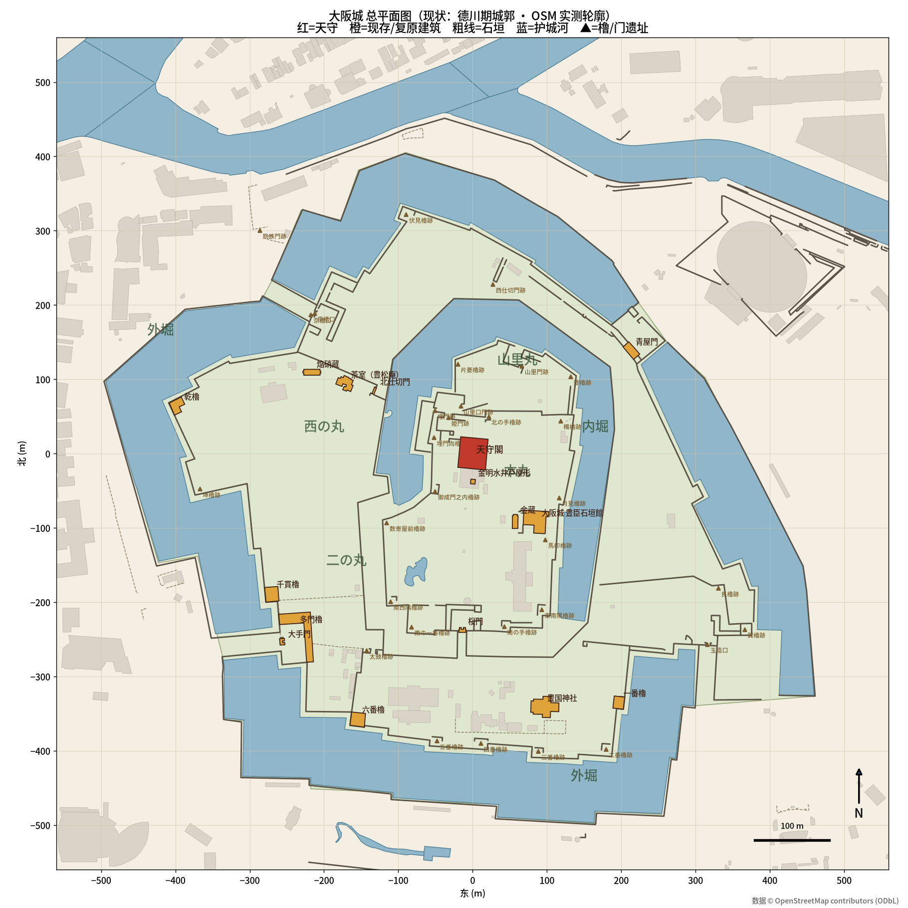
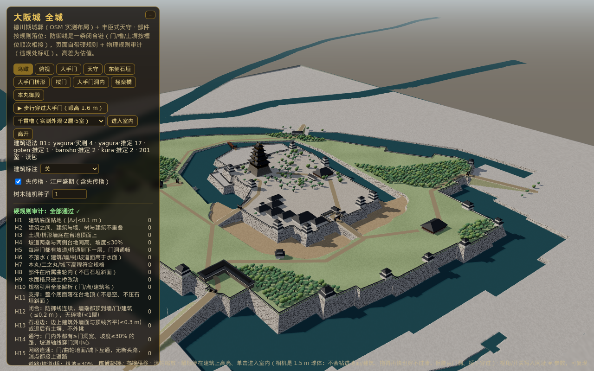
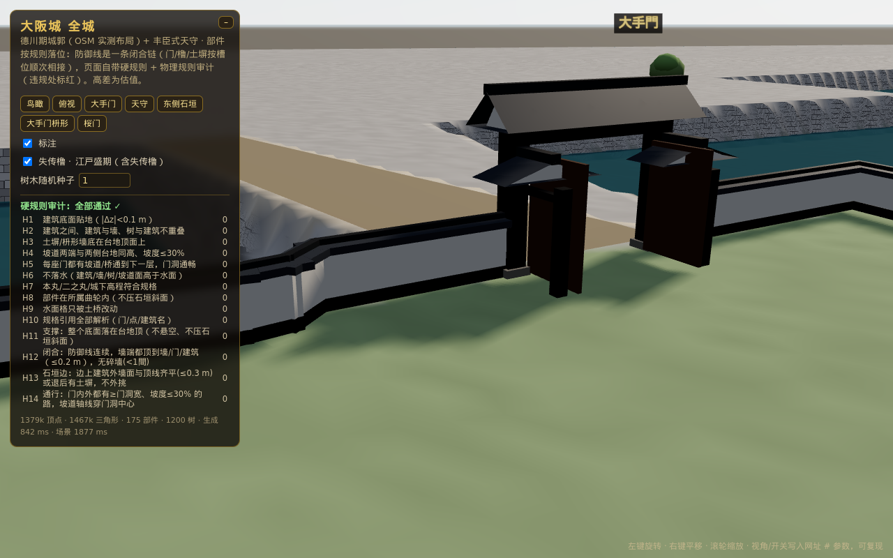
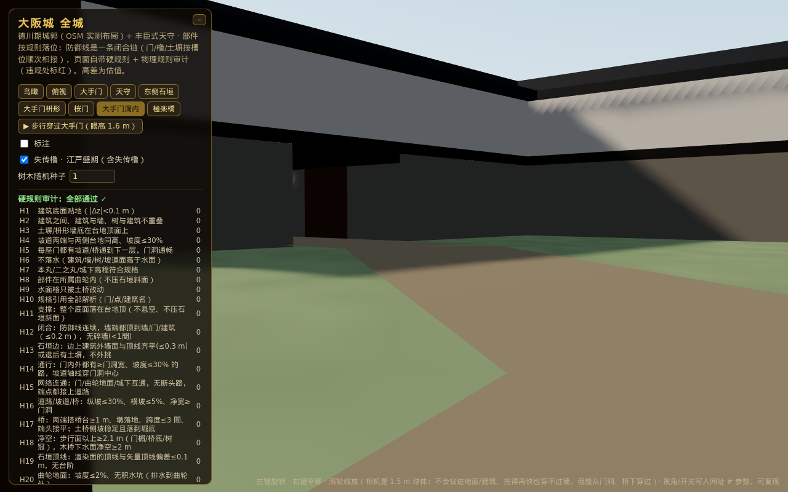
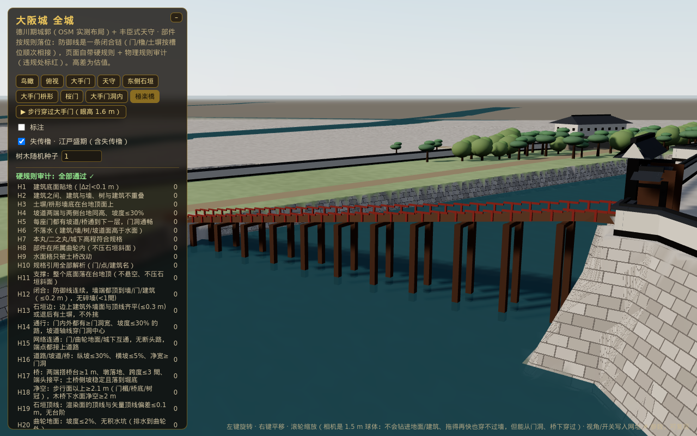

# 大阪城 3D 复刻（Osaka Castle 3D）

在本地 Blender（Mac mini）中程序化复刻大阪城全城，导出 GLB，用浏览器离线浏览。

- **城郭布局**：现存德川期（1620–1629 再筑）城郭，护城河、石垣、门、橹按 OpenStreetMap 实测轮廓放置。
- **天守**：采用丰臣期（1585）天守的复原想象（黑漆壁、金箔瓦、五重屋顶），与 1931 年复兴天守的思路一致：德川天守台 + 丰臣式天守。



## 目录
| 路径 | 内容 |
|---|---|
| `data/osm.json` | OSM 原始数据（ODbL）。web-r7a：OSM API 0.6 `map` 按 2×2 块取全城 bbox（Overpass 主站/镜像 406/500/超时），按 `data/q.txt` 的标签过滤；含水体、石垣/挡土墙、建筑、遗址、道路、树、草地/林地、桥、门 |
| `tools/geodata.py` | 实测数据读取（离线）：GSI DEM5A 瓦片、PLATEAU CityGML → 本地米制 |
| `tools/fit_terrain.py` → `data/fit_r7.json` | r7 离线拟合：台地面（常数/平面，T.P.）与 DEM 残差、每个水体的水位、PLATEAU 石垣勾配、墙脚线对实测线的偏差；报告见 [docs/R7_FIT.md](docs/R7_FIT.md)。**web-r7b 起进入模型**（经 `tools/make_webdata.py` 写进 `web/data.js` 的 `fit`） |
| `data/castle_layout.json` | 转为本地米制坐标（原点=天守，x 东 y 北）的护城河、石垣、建筑、遗址点 |
| `tools/extract_layout.py` | osm.json → castle_layout.json |
| `tools/draw_plan.py` | 生成总平面图 `docs/site_plan.png` |
| `tenshu/build_tenshu.py` | Blender 天守建模脚本（v0，已完成） |
| `blender/build_castle.py` | 全城建模脚本（进行中） |
| `docs/REFERENCES.md` | 史料与参考资料 |
| `docs/ROADMAP.md` | 分阶段计划 |
| `docs/RULES.md` | **规则手册**：H/C 各规则的物理不变量、参数来源、容差、算法、设计理由与下一步规则路线图 |
| `web/` | 浏览器版：规则驱动生成 + 硬规则自检（见下） |

## 浏览器版（规则驱动 + 物理自检，web-r7b 第 1 阶段）
在线：<https://htmlpreview.github.io/?https://github.com/changrong996-droid/osaka-castle-3d/blob/main/web/index.html>（也可直接用 GitHub Pages / 任意静态服务器打开 `web/index.html`）

不再在 Blender 里手放坐标：`web/site.js` 里是一份**声明式规格**，所有部件按引用定位，页面打开时现场生成并自检。这不是有物理引擎的世界模型，所以“物理”写成**抽象的几何不变量**（支撑、接触/闭合、石垣边、通行、不穿插），生成时按构造满足，审计时用通用算法检查（支撑采样、接触图、栅格寻路），不针对具体部件写坐标。全部规则的不变量/参数/容差/算法见 [docs/RULES.md](docs/RULES.md)。日本城郭的惯例（1 間≈1.97 m、角橹在石垣转角、土塀止于柱/橹/门、枡形=高丽门+直角渡橹门）只用来定参数。
- **地形**：1.5 m 高度网格，按顺序执行：曲轮台地填充 → 外堀外圈分离（在土桥颈处切开、洪泛，外圈归城下 0 m）→ 石垣扇勾配（多边形边=墙脚，0.22×高、≤6 m 内收；外圈专属的边不削内侧转角）→ 建筑/墙体地基整平 → 土桥坡道。水面格只允许被土桥改动。
- **防御线 = 一条闭合链（web-r2）**：本丸、二之丸（在土桥颈处用颈切线截断）各取外边界 → 逐边内缩 B 得到**石垣顶线**，再内缩 0.9 m 得到**土塀轴线**（斜接内缩 + 自交切除 + 按距离场修正深石垣端头）。门和建筑先占位，再沿轴线做“槽位序列”：被门/橹/建筑占住的区间之外**全部**是土塀，每段土塀的端头正好顶到相邻部件的面上，转角处斜接相连——不再是“先放建筑再在墙上开口”。
- **部件规则族**：门锚在实测位置/遗址点，吸附到所在防御线的石垣顶线（门外侧面与顶线齐平，门不跨转角，主柱立在土塀轴线上）；土桥颈上的门就在颈切线上；坡道从门洞中心沿外法线射出。现存橹（千貫/六番/一番/乾）按“面贴边”规则平移到外墙面与顶线齐平；失传橹吸附到最近石垣、近转角滑到角上，非直角转角时沿主边滑开、主面保持贴边。枡形：门内方院由射线碰到的建筑/防御线或默认 24 m 围出；三边石垣矮墙斜接，遇建筑/防御线截断（端头顶齐）；里门开在侧边与外门成直角——大手门穿过实测多门橹（门洞切开石垣台座），其余新建渡橹门（紧贴防御线或顶到后角，剩余墙段 ≥1 間）；方院太浅（京桥口窄颈）就加深。
- **审计**（页面左侧面板，违规处标红）：H1 建筑贴地 · H2 不穿插（墙端斜抵到面上的那一角算抵接，不算穿插）· H3 墙底在台地顶 · H4 坡道两端同高且≤30% · H5 门有坡道/桥 · H6 不落水 · H7 曲轮高程 · H8 在曲轮内 · H9 水面只被土桥改 · H10 引用全部解析；**新增物理规则** H11 **支撑**（每个部件整个底面、墙两面、树根都在台地顶/平地上，不悬空不压石垣斜面）· H12 **闭合**（防御线 0.5 m 采样全被土塀/门/建筑覆盖，墙端都在 0.2 m 内顶到墙端/门柱/建筑面，无 <1 間碎墙，枡形方院门关上后洪泛出不去）· H13 **石垣边**（离顶线 <3 m 的建筑外墙面与顶线齐平 ≤0.3 m，或退后但前面有土塀；外挑 ≤0.3 m）· H14 **通行**（0.5 m 栅格上从门洞出发，坡≤30%、净宽≥门洞，向外走到坡道/桥另一端、向内走到 45 m 外的曲轮地面；坡道轴线穿门洞中心且垂直于门）。用同一套 H11–H14 检查 web-r1 的布局会报 194 项（171 个悬空墙端、19 个石垣边留缝/外挑、3 座门内走不通）。
- **可复现**：视角/种子/失传橹开关写在网址 `#seed=1&lost=1&view=aerial&labels=1`；视角含两个接缝特写 `otejoint`（大手门枡形内）、`sakura`（本丸桜门枡形）与 `otegate`（站在大手门门洞里、眼高 1.6 m）；面板上“▶ 步行穿过大手门”沿 H14 路线以眼高走过高丽门→枡形→多门橹门洞。
- **相机 = 物理体（web-r3，`web/camera.js`）**：相机是半径 1.5 m 的球。页面加载时把场景**真实几何**（所有建筑/墙/门/桥/天守三角形精确保守栅格化到 1.5 m 格，树按实例包围盒）+ 高度网格 + 水面合成柱状碰撞场 T，再膨胀 R 得到“球心最低高度” C（约 0.1 s）。① **每帧约束**：OrbitControls 更新后若球心低于 C，取位移最小的修正（竖直抬升 / 沿视线朝目标收回），目标点不低于地面；② **视角 = 规则**：每个视角只写“看什么（目标点）+ 从哪侧（方位角/仰角）+ 多远 + 目标本体半径”，相机位置由规则推出，若不清空或视线被挡，按代价（距离/仰角/方位偏差）搜索最近的清空且通视的位置；③ **过渡动画**：直线插值 + 抬升包络（沿路径每 0.75 m 求球心缺口，用余弦核展开，抬升 ≥ 缺口、端点为 0），easeInOutCubic，0.8–1.2 s，用户一拖动就中断；④ **近裁剪面**按规则取最大值使近平面四角距相机 ≤0.9R（=1.11 m，比 r2 的 0.5 m 深度精度更好，又不会切掉近处墙面）。
- **相机 = 自由空间里的球（web-r4，可穿门洞/桥下）**：r3 的柱状场（每格最低球心高度）让球心永远在门楣/桥面之上。r4 改为**精确间隙**：碰撞三角形放进 3D 空间哈希（4×4×6 m 桶，约 16 万三角形；细网格外由曲轮平面代表），加地形三角网（与渲染网格同剖分）、水面、树（树干/树冠各自的真包围盒，可从高树冠下走过）；球心合法 ⇔ 到一切几何的距离 ≥R。柱状场保留为**充分条件快速通道**（球心高于它必合法，87% 的查询走这里）和兜底。① **可达性**：自由空间 = 从天空出发球体连续运动能到达的点。连续运动用**扫掠**（0.5 m 采样 < 2R，零厚度面也穿不过），碰到后二分求接触点、沿接触面切平面滑移（≤3 次）——所以拖得再快也穿不过墙，但能从门洞两头走进去；瞬移（预设/重建/跳转）要求落点“向上开放”（竖直扫掠到柱状场之上全程合法），否则沿间隙梯度推出、再按壳层找最近的开放合法点，最后才竖直抬升——球永远不会出现在封闭建筑内部。② **过渡**：先试直线；不行时，端点若在遮盖下（门洞里）先用 1 m 3D 栅格 Dijkstra 找最近的开放点（逃逸段，拉直）；中段先试按精确间隙求的最小抬升包络（余量 0.3/1/2 m，整段复核），不行再用 r3 柱状包络。r3 的 42 对过渡里 6 对抬升 >5 m（合计 74 m），r4 同样 42 对只剩 4 对（合计 58 m），其余都是直线。③ **步行**：眼高 1.6 m（坡道上为让球离坡面 ≥R 最多抬 0.3 m；r=1.5 m 的球在最矮的门洞——渡橹门门楣 4.0 m、多门橹通道 4.1 m——里头顶仍有 ≥0.9 m 余量，所以不需要缩小球半径）。多门橹通道里的两扇门改为开着贴在侧壁上（H14 说门洞可通行，门扇就不能横在通道里）。④ **桥下**：两座木桥（極楽橋、東橋）桥面下 16 m 净空，横穿桥下的直线扫掠全程合法且两端开放；土桥是实心土堤，不能穿。碰撞场 + 哈希 ~0.24 s，页面加载 ~1.9–2.4 s（r3 ~1.8–2.8 s）。
- **相机审计**（面板第二张表，测试里也断言）：C1 视角相机球体不在实体/地下/水下 · C2 视角→目标视线无遮挡 · C3 任意两视角间过渡路径 0.25 m 采样全程清空 · C4 随机旋转/平移/缩放模糊测试（含把目标平移到全城任意处）相机始终清空 · C5 近平面四角在相机球内 · **C6**（r4）每座门：眼高 1.6 m 的相机球沿 H14 路线（坡道/桥外端 → 门洞中心 → 45 m 外曲轮地面，1 m 栅格寻路、坡≤30%）全程合法、真的穿过门洞（失败门数）· **C7**（r4）快速拖动/推拉穿过目标/大幅平移模糊测试（从门洞内、枡形、桜门、东侧石垣、天守 5 个视角各 120 步）：相邻两帧之间球心实际运动折线不与任何三角形/地形/树盒相交。另用**不经碰撞场的独立校验**（三角形空间哈希 + 球-三角形精确距离 + 地形 + 封闭性：头顶与 16 个方向射线全被挡 = 封闭体内）复核 C1/C3/C4，并用真实鼠标滚轮/拖动输入复核。同一套检查下 r2 的相机逻辑：C2 2 · C3 16 对视角过渡穿模 · C4 400 步里 60 步在实体/地下（独立校验：14 对过渡、600 步中抽查 120 步有 13 步穿模）；r3 全部 0。另外 r2 的 tenshu/eastwall 预设仰角为负，会被 OrbitControls 的 maxPolarAngle 悄悄改掉。
  r4 结果：C1–C7 全 0（独立校验 C1/C3/C4/C6 也 0）；用同一套 C6/C7 检查 r3 逻辑（柱状场 + 抬升）：**C6 9/9 门失败**（球心永远在门楣之上）、**C7 11 次穿墙**（快速推拉时被“抬”到墙另一边）。
- **道路与桥 = 可步行表面网络（web-r5）**：端点（每座门沿门洞轴线走到净宽够处、坡道外端、枡形里门两侧、天守/殿舍外圈）+ 边（穿门段、坡道/土桥/木桥、曲轮内道路）。曲轮内道路 = 门关上后每块连通地面（曲轮、每个枡形方院）上端点的 Steiner 树（3 m 格多源 Dijkstra → Voronoi 端点对 → MST → 按净宽场拉直），路两侧都在平地上。木桥按支撑/跨度规则生成：桥面两端各搭 1 m 在桥台上（接触段地面整平到桥面顶），桥墩只落在平整的堀底、每跨 ≤3 間（5.9 m），栏杆只在桥面以上。土桥侧坡按“站在什么上”选勾配：护城河底/原石垣面上为石垣面（0.3），平地（陆地颈）上为土坡（1.5），落地前会撞上岸边的一侧整段做成石垣面。树冠伸进路上空时冠底必须 ≥2.1 m。新审计 **H15** 网络连通（门/曲轮地面/城下一个连通块、无断头路、端点都接上道路）· **H16** 纵坡 ≤30%、横坡 ≤5%、净宽 ≥门洞 · **H17** 桥台搭接 ≥1 m、墩落在平地、跨度 ≤3 間、端头接平、土桥侧坡按材料够缓 · **H18** 步行面以上净空 ≥2.1 m（门楣/桥底/树冠）、木桥下水面 ≥2 m；相机 **C8** 贴水面从两座木桥下两墩之间横穿。`node tests/test_faults.js` 对每条新规则注入故障（堵门洞、截断道路、路上放障碍、抬高路面一侧、拆桥墩、桥墩悬空、桥头错台、侧坡去石垣、压低门楣、路上种树、桥压到水面）全部被抓到。用同一套 H15–H18 检查 r4 布局：H17 9 项（两座木桥的桥台搭接不足 ×4、桥墩立在石垣斜面上 ×3、跨度 7.6 m ×2），其余 0。（更正：r5 当时说“OSM 没有道路”是错的——是 `data/q.txt` 的查询没有请求 `highway`。web-r7a 起 `data/osm.json` 含全城 bbox 的道路 1 132 条（footway 751、steps 116、service 100、pedestrian 55 …）、单株树、草地/林地、桥、门；目前道路仍由门的通行路线派生，OSM 道路作为后续“实测边优先”规则的数据。）
- **地形顺从边线（web-r6）**：1.5 m 网格让石垣顶线和台地边缘成了锯齿台阶。现在石垣顶线（解析扇勾配面到达台地顶的等值线）和墙脚线（OSM 曲轮边）是地形的**约束边**：与它们相交的格子按线切开（格边切点相邻格共用、逐位相同；墙脚线不分曲轮按折线连通性配对，顶线按台地高程配对，线在格内拐弯时插入拐点，线在格内终止时接到墙脚线上），后来的整平/坡道/桥台改到的格退回网格并重放整平，最后给邻格做被动扇形保证水密。seed 1：切开 15 242 格、被动 963 格、退回 337 格；**37 格**（三类交汇的多边形顶点附近）仍是中心扇形兜底，列在 RULES.md 里，审计在那里跳过。渲染（`app.js`）与相机碰撞（`camera.js`）用同一张切分三角网。新审计 **H19** 顶线偏差 ≤0.1 m · **H20** 台地坡度 ≤2%、无积水坑 · **H21** 实测勾配 = 设计勾配（±0.03）、墙脚 = 下层高程；旧网格（`build({conform:false})`）下 H19 125 条边、H20 704 格、H21 119 条边，现在全 0，故障注入 6 项全部抓到。首次加载的 H 审计改在第一帧之后跑（面板先显示“运行中”，约 1.1 s 后出结果）；页面加载到可交互中位 2.34 s（同机 r4 2.11 s = 1.11×，r5 2.35 s）。
- **实测数据（web-r7a）**：OSM 重新抓取全城（含道路/树/草地/桥/门，见上表）；本丸南缘不再用 `make_terrain.py` 里手抄的 15 个点，而是**规则从 123 条 OSM 挡土墙里选出本丸石垣线**：高侧 8 m 处 DEM5A 在本丸台地高程（31.2 m T.P.，±3 m）且落差 ≥1.5 m 的挡土墙，按“缺口 ≤12 m（最宽门洞）算开口”首尾相连，取最长链（自动选中 363432471、405236726 及其延续 512691526、363432470）。新边界与旧手抄线差 ≤11 m（西南角折线）、面积差 0.5%。新增生成侧**排水整平**：有防御线的曲轮里，坡道侧坡与石垣面相交留下的闭合洼地按溢出水位填平（seed 1：1 格，西土桥侧坡脚）。兜底扇形格 37 → 34。页面加载中位 2.56 s（同机 r4 2.26 s = 1.13×，r6 2.40 s）。
- **实测高程进模型（web-r7b 第 1 阶段）**：高程基准改为 **T.P.**。台地面 = DEM5A 拟合（`data/fit_r7.json`）：本丸主台地 31.78、**山里丸 19.83**（本丸实测石垣链外的下层台地，单独成区）、天守台 35.72、干堀 17.36、二之丸为 2.8% 的**斜面台地**、城下+外圈为一个 1.7% 的连通平面。水面按连通水体分开、各用自己的水位（PLATEAU：内堀 9.00、南外堀 8.79、西外堀 5.82、东外堀 4.43、北外堀 3.47；其余为岸线估值），兜底水面压到全部地面以下（修正东北角被淹）。石垣勾配改为 PLATEAU 实测中位 **0.40**（去掉 6 m 退距上限），H21 设计范围 0.24–0.54（实测 p10–p90）。生成器、审计、相机全部按“台地面是 x,y 的函数”重写；斜面台地上建筑用水平地板 + ≤1.5 m 基础。删除推定的“東橋”（实测落差 ~17 m，按 30% 坡度需 ≥57 m 桥长且首跨落不了墩，且无实测证据）。顺带修正几条通用规则（墙体按横截面占位、墙端按端面顶住、寻路边连续复核、陆地多边形整体简化等，见 RULES.md）。兜底扇形格 34 → 15。页面加载中位（同机 7 次 ×3 轮合计 21 次）：r4 2.20 s · **r7b 2.64 s（1.20×）**。
- **测试**：`python3 tests/test_web.py`（headless Chromium：无控制台错误、审计 H1–H21=0（江戸盛期/现状/换种子）、相机审计 C1–C8=0、相机用的是切分地形（`cam_terrain`） + 步行穿大手门逐帧（合法、不穿几何、确在遮盖下） + 额外 3×1500 步模糊测试 + 56 对视角过渡逐帧（合成时钟驱动真实 step()）+ 独立几何校验 + 真实鼠标输入、同一网址签名一致、9 个视角截图（含门洞内、極楽橋侧面）到 `web/shots/`）、`tests/test_faults.js` 故障注入 + C8 故障注入（`#fault=c8`）。数据更新后先跑 `python3 tools/make_webdata.py` 重新生成 `web/data.js`。
- 文件：`web/index.html` · `web/site.js`（规格+生成+审计，纯数据，node 可跑）· `web/app.js`（three.js 渲染/界面）· `web/tenshu.js`（丰臣式天守模块）· `web/camera.js`（相机物理体：碰撞场/约束/视角规则/过渡路径/独立校验，不依赖 three.js）· `web/data.js`（内嵌数据）· `web/vendor/`（离线测试用 three r160）。






## 运行（旧 Blender 流程）
```bash
python3 tools/extract_layout.py data/osm.json data/castle_layout.json
python3 tools/draw_plan.py data/castle_layout.json docs/site_plan.png
/Applications/Blender.app/Contents/MacOS/Blender -b --python blender/build_castle.py
```

地图数据 © OpenStreetMap contributors，ODbL 1.0。
